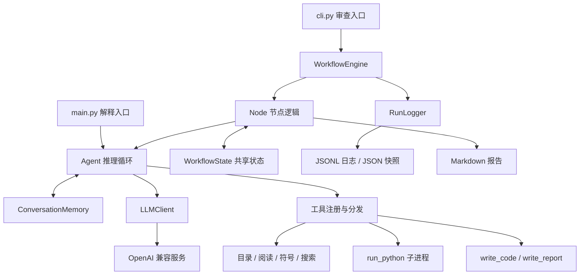
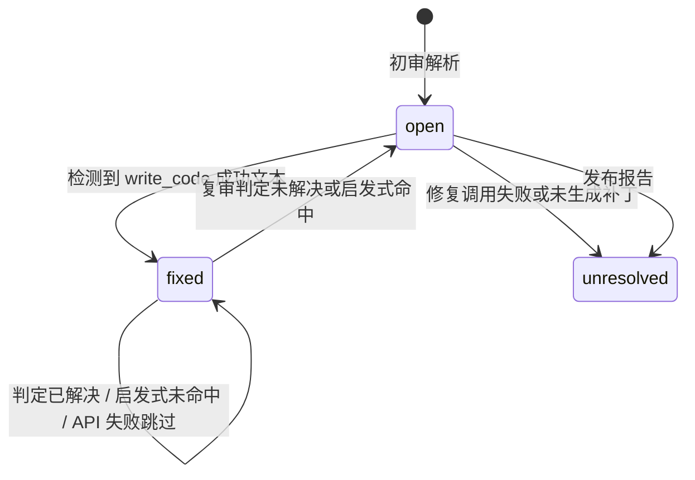
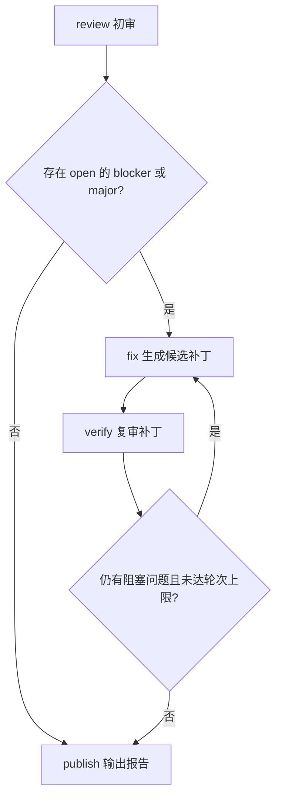

# 设计说明：代码审查与修复工作流

使用方法见 [README.md](README.md)

## 1. 目标与范围

项目将代码理解任务拆成可观察的工具调用，将代码审查任务拆成明确的处理节点，使模型生成的问题可以进入补丁生成和复审流程。

当前包含两个入口：

- `main.py`：面向用户的代码解释和追问，由一个 explainer Agent 维护会话。
- `cli.py`：面向文件的审查工作流，按需创建 reviewer、fixer、reviewer_verify 三个逻辑角色的 Agent 实例。

三个工作流角色按顺序运行，通过 `WorkflowState` 交换数据，并非并发运行的独立服务。项目尚未实现自动合并、完整仓库构建验证、操作系统执行沙箱或工作流断点恢复。

## 2. 架构与依赖

| 模块 | 责任 | 主要接口 |
| --- | --- | --- |
| `config.py` | provider 配置、环境变量加载 | `load_settings()`、`Settings` |
| `agent/roles.py` | 角色与允许向模型暴露的工具集合 | `AgentRole`、`register_role()` |
| `agent/core.py` | 对话推进和工具执行 | `Agent.ask()`、`AgentResult` |
| `agent/llm.py` | API 请求、重试、统一响应 | `LLMClient.chat()`、`ModelReply` |
| `agent/memory.py` | 消息管理、估算与裁剪 | `ConversationMemory` |
| `agent/parsing.py` | 从模型文本构造问题与复审判定 | `parse_issues()`、`parse_verdicts()` |
| `tools/` | schema、装载、分发与实际工具 | `schemas()`、`invoke()` |
| `workflow/state.py` | 数据模型与状态查询 | `Issue`、`WorkflowState` |
| `workflow/node.py` | 节点、路由条件和任务提示 | `Node`、`Runtime`、`build_workflow()` |
| `workflow/engine.py` | 节点调度、重试与兜底 | `WorkflowEngine.run()` |
| `workflow/logger.py` | 过程记录和最终产物 | `RunLogger` |

该分层使工具与解析器可以脱离模型测试，角色、工具、节点也可以分别扩展。不过工具仍自行加载全局配置，节点表和角色表也是进程级全局对象，尚未实现完整的依赖注入和运行隔离。

## 3. Agent 循环

一次 `Agent.ask(question)` 的主要步骤：

1. 将用户问题加入当前会话。
2. 在每个推理步骤前估算上下文长度，必要时裁剪历史。
3. 将消息、角色温度和该角色的工具 schema 发给 `LLMClient.chat()`。
4. 若模型要求工具调用，保存 assistant 消息、执行工具、追加 tool 结果，再请求模型。
5. 若模型输出最终文本，加入会话并返回 `AgentResult`。
6. 达到步数上限时返回提示文本，设置 `stopped_by_limit=True`；捕获 `LLMError` 时返回 `error`。

`AgentResult` 保存回答、步骤数、工具调用记录、耗时、是否触达上限和错误。工作流节点目前主要判断 `error`，没有完整处理 `stopped_by_limit`，因此“达到限制”和“成功完成”尚未严格区分。

### 模型适配与重试

`LLMClient` 使用 `openai.OpenAI` 客户端调用 Chat Completions，底层 SDK 重试设为 0，由本项目控制尝试次数。

- 429、5xx、网络错误会重试；明确的其他 4xx 通常不重试。
- 等待时间为指数退避加少量随机抖动。
- `LLM_MAX_RETRIES` 实际控制包含首次请求的总尝试次数。
- 思考模式通过 provider 配置中的 `extra_body` 传入。
- 响应统一为 `ModelReply`，包含文本、工具调用、assistant 历史消息和 token 用量。

目前只内置一个 provider；添加其他 provider 还需验证工具协议、参数与响应字段兼容性，不能仅更换模型名。

### 上下文与持久化

`ConversationMemory` 保留 system prompt、用户消息、assistant 消息和工具结果。长度按字符数粗估，并非模型 tokenizer 的精确计数；默认预算约 120,000 tokens，默认保留最近 24 条消息。

裁剪优先寻找 user 消息边界；找不到合适边界时按消息数量截断，可能切断工具调用与结果的对应关系。工作流 Agent 默认不保存会话，解释入口可以保存和恢复 `.agent_memory/last_session.json`。

## 4. 角色与工具

| 角色 | 默认最大步骤 | 工具 schema |
| --- | --- | --- |
| reviewer | 14 | list_dir、list_symbols、read_code、search_code、run_python |
| reviewer_verify | 12 | 同 reviewer |
| fixer | 10 | 同 reviewer，增加 write_code |
| explainer | 12，可由命令行调整 | 同 reviewer，增加 write_report |

角色保存提示词、工具名称、温度和步骤上限。工作流角色温度为 0，解释角色为 0.2。`READONLY_TOOLS` 中的“只读”仅表达提示词意图：其中的 `run_python` 实际可以执行有副作用的代码。

工具使用 JSON Schema 描述名称、说明及参数，由 `@register` 装饰器注册，`tools.loader` 按名称导入模块。`invoke()` 将未知工具、参数错误和处理异常转换为文本，让模型看到错误后调整策略。

| 工具 | 实现与限制 |
| --- | --- |
| `list_dir` | 深度限制 1–4，最多 300 个条目 |
| `list_symbols` | Python AST；其他语言正则粗提取；最多 200 条 |
| `read_code` | 编码回退、行号范围；正文最多 24,000 字符 |
| `search_code` | 正则、glob 与上下文；最多 60 个命中、20,000 字符 |
| `run_python` | 临时脚本、子进程、1–30 秒超时；stdout/stderr 各在执行后截断至 6,000 字符 |
| `write_code` | 校验源文件，写完整 UTF-8 候选文件到 patched/ |
| `write_report` | 清理文件名，写 Markdown 到 reports/ |

工具 schema 的角色过滤当前没有在执行时再次校验。模型返回一个未向该角色暴露、但已全局注册的工具名时，分发器仍可执行它。

## 5. 数据模型

### Issue

| 字段 | 含义 |
| --- | --- |
| `id` | 解析时生成的 `R-001` 等本次结果内编号 |
| `file` | 相对于工作区的文件路径 |
| `line_start`、`line_end` | 问题所在的闭区间行号 |
| `severity` | blocker / major / minor / info |
| `category` | bug / security / perf / style / maintainability / test |
| `title`、`reason`、`suggestion` | 标题、证据说明、修复建议 |
| `line_verified` | 模型自报是否实际读到相关行，不是工具层证明 |
| `status` | open / fixed / unresolved / wontfix |
| `verify_note` | 复审证据文本 |

`blocker` 与 `major` 是阻塞问题，默认进入自动修复。`wontfix` 只在模型定义中预留，当前工作流没有设置该状态的路径。

当前状态转换：

这里的 `fixed` 同时承担“生成了候选补丁”和“确认修复”的含义，是当前可信度问题的主要来源。

### WorkflowState 与 Runtime

`WorkflowState` 保存运行 ID、目标、问题、初审问题列表、原文件到最新补丁的映射 `patches`、补丁文件列表、修复轮次、节点历史、未解决项、报告路径和结束标记。

`Runtime` 提供 settings、Agent 工厂、运行目录、日志对象和 `read_files` 集合。该集合当前会直接加入审查目标，并不对应完整的真实工具阅读轨迹。

`original_issues = list(issues)` 只复制列表，内部 Issue 对象仍与当前问题共享。因此后续状态修改会改变“初审问题”，最终 `review.json` 不能用于还原不可变的初审现场。

## 6. 工作流与分支

### review

审查提示要求先列结构、精读、必要时执行片段，再输出包含 `issues` 的 JSON。`parse_issues()` 查找对象、检查必需字段、文件和行号；完全没有可用问题且有格式错误时，向模型反馈错误并追加一次格式纠正请求。

初审模型错误目前会清空问题并返回说明文本，因此引擎仍把节点记为 `ok`。格式纠正后仍无合法问题时也可继续发布零问题报告。

### fix

选取状态为 open 的阻塞问题，按严重度排序，一轮最多取 6 条，再按文件分组。每组要求一次性修复该文件的全部选中问题。已有补丁时从 `state.patches[file]` 继续修改，保留前轮改动。

通过工具调用记录中的“已写入补丁文件：”文本提取路径；有路径就把整组问题标为 fixed，否则标为 unresolved。补丁路径没有通过结构化结果返回，也没有校验候选文件的语法、行为或是否对应当前分组源文件。

### verify

逐文件读取最近补丁，要求返回 `verdicts` 与 `issues`。存在原问题 ID 的判定时更新证据；判定未解决则重新标为 open。缺少判定时，用同类别问题的标题相似度或行号距离作为启发式兜底。

当前复审 API 错误直接跳过，解析错误未形成失败状态；缺少判定且没有匹配问题时按已解决处理。新问题仅参与旧问题匹配，没有合并到 `state.issues`。

### publish

收集 open/unresolved 项，将 open 转为 unresolved，生成目标、问题清单、节点历史和补丁映射报告。没有未解决项时输出成功结论，尚未综合判断此前节点失败与复审有效性。

### 调度与重试

`WorkflowEngine` 按节点注册表执行，按声明顺序求条件，未命中时走默认边。默认每节点总尝试 2 次，仅节点抛出异常才重试；模型错误若已转换为返回值，不触发节点重试。

引擎最多执行 20 次节点跳转。在 `finally` 中尝试兜底发布、写日志和保存状态，尽量保留产物。该机制提高可观察性，但“有报告”目前不能推出“执行成功”。同一引擎对象还会复用 Agent 实例及其会话，不宜用于未经隔离的并发请求。

## 7. 解析与真实性校验

问题解析器可从 Markdown 代码块或正文搜索 JSON 对象，并允许整数被表示为数字字符串。

- 文件必须在工作区源码行数索引中。
- 行号需为正且区间有序。
- 超过总行数的问题被降为 info，并钳制行号。
- 非法严重度降为 minor，非法类别降为 maintainability。
- 文件存在与行号合法只能证明引用位置可能存在，不能证明缺陷成立或已真实阅读。

`line_verified` 和复审 `resolved` 当前通过 Python `bool()` 转换，字符串 `"false"` 会变成 True。

## 8. 路径与执行边界

`resolve_workspace_path()` 对相对路径拼接工作区，解析真实路径后使用父目录关系检查越界，直接读取与写入工具会调用该函数。这比字符串前缀检查更可靠。

仍存在以下边界缺口：

1. 入口的 `Settings.workspace` 未注入工具；工具重新调用 `load_settings()`，默认使用进程当前目录。`cli.py` 固定入口工作区为自身目录，`main.py` 接受 `--workspace`，二者均可能与工具实际工作区不一致。
2. 目录遍历与搜索没有对每一个后代路径统一执行同样的真实路径检查，需要进一步处理符号链接与 Windows junction。
3. `run_python` 过滤部分敏感环境变量并设置超时，但可以访问文件、网络、创建进程；工作目录不是访问控制边界。
4. `subprocess.run(capture_output=True)` 先收集完整输出，之后才截断显示，不能防止运行时内存被大量输出消耗。

## 9. 日志与产物

每次运行使用秒级时间戳生成目录 `runs/<run-id>/`，包含 `run.jsonl`、`report.md`、`review.json`、`state.json`。补丁独立写入工作区的 `patched/`，通过状态映射关联。

JSONL 每条立即 flush，记录节点开始/结束、分支错误及部分 Agent 事件。部分文本按 400 字符截断；日志并非完整的模型请求/响应或可重放执行记录。状态快照不包含恢复协议。

当前时间戳精度只有秒，同秒运行可能冲突，且日志以写入模式打开。常规 publish 在自己的 NodeRecord 入历史前生成报告，因此报告表格不包含本次 publish 的完成记录，最终 state.json 会包含该记录。

## 10. 测试现状与改进设计

### 现状

现有 `tests/offline_test.py` 是直接执行的脚本，检查文件、语法、配置和工具 schema。2026-10-24 验证为 19 项通过、1 项失败，失败是重构后的路径断言未更新。

本次另用模拟模型结果验证了审查失败、复审错误、新增问题丢失、工作区不一致、工具越权分发、布尔解析及工具消息配对等问题。

## 11. 扩展点

添加工具：实现模块、使用 `@register(schema)` 注册，更新 `tools.loader._MODULES`，再添加到适用角色。实现权限检查前，不能把角色 schema 过滤视为安全保证。

添加角色：构造 `AgentRole` 并注册，提供提示词、工具集合、温度和步骤限制。

添加节点：实现 `(state, runtime) -> str` 函数，在 `build_workflow()` 注册节点和分支。`reads/writes` 当前只是描述性元数据，引擎不校验实际读写。

添加 provider：扩展 `PROVIDERS`，验证请求参数、思考模式、工具消息和用量字段，并通过假客户端及可控的集成测试确认兼容性。
